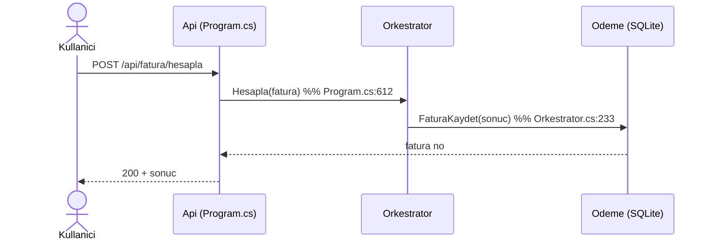

> Bu sayfa skill/rontgen/references/belgeler.md dosyasının çevirisidir; kaynak İngilizce metindir.

# Belge kümesi — şablonlar ve onları dürüst tutan kurallar

Bunu adım 6'da, yazmadan önce okuyun; adım 4'ün okuması o zamana dek
bitmiştir. Üretilen iki dosya (`rontgen.md`, `yapi.md`) o zamana dek zaten
vardır; aşağıdakiler bir okuyucunun yazdığı belgeler ve onların kendinden
emin bir kurguya dönüşmesini neyin önlediğidir.

## Tek kural: her okun ve her cümlenin bir kaynağı vardır

Bir diyagram bir iddia kümesidir. Her ok "bu onu çağırır" ya da "bu onu
okur" der ve okuyucu ona düzyazıdan daha çok güvenir, çünkü bir ölçüm gibi
görünür. Bu yüzden:

- **Atıf yap ya da katmanla.** Her ok, adım ve ifade bir kaynak
  (`file:line`, bir test adı, `yapi.json`'ın bir satırı) ya da `[H]`
  etiketini taşır. Kaynaksız bir diyagram bütünüyle `[H]`'dir ve bunu
  başlık yazısında söyler.
- **İzle, anımsama.** Bir akış, giriş noktası açılıp çağrılar birer adım
  izlenerek çizilir. Bir adım yansıma (reflection), bağımlılık enjeksiyonu,
  bir kuyruk ya da bir kural motoru üzerinden geçiyorsa, ok orada durur ve
  boşluk diyagramın üzerine yazılır — kodun "muhtemelen" yaptığıyla
  köprülenmez.
- **Siz değil, başkası denetler.** `python scripts/atif.py --docs <dir>
  --ornek 12` atıf yapılmış cümlelerden rastgele bir denetim listesi çeker.
  Bu liste belgeleri yazmamış bir okuyucu tarafından doldurulur — bir kişi
  ya da yalnızca belgeler ve depo verilmiş yeni bir oturum. Yazarın kendi
  atıflarını yeniden açması satırın var olduğunu kanıtlar, onun hakkındaki
  cümlenin doğru olduğunu değil. Kapsam ifadesinde "12'den N'si tuttu" diye
  bildirin; başka kimse yoksa **hakem = yazar** deyin ve belgeler küme
  olarak `[H]` kalır.
- **Okuduğunuzu, okurken yazın.** `okunan.tsv`:
  `path<TAB>from<TAB>to`, açılan her aralık için bir satır.
  `scripts/kapsam.py` onu kapsam defterine çevirir — modül başına,
  belgelerin ne kadarına dayandığı ve sonraki dilimin hangisi olduğu. O
  olmadan defter "olculmedi" der ve anımsanan "modülün beşte biri kadar",
  anımsanan her sayı ne kadar değerliyse o kadar değerlidir (ilk koşuda %14
  ve deponun %6'sıydı).
- **Bir atıf commit'i ve bir çapayı taşır.** Satırların ait olduğu commit'i
  belirtin ve yalnızca satırın numarasına değil, üzerindekine atıf yapın
  (`Program.cs:452` `Yetkili`). Sıcak bir dosyadaki satır numaraları saatler
  içinde çürür: ilk gerçek koşuda 162 atıftan on beşi on bir satır kaymıştı,
  çünkü okuma ile yazma arasına başka bir commit girmişti — ve üç okluk
  örneklem geçmişti. Bu yüzden okurken bir yan dosya `atiflar.tsv` tutun —
  `path<TAB>line<TAB>text on that line`, en üstte `# commit: <sha>` ile — ve
  teslimden önce `python scripts/atif.py --repo . --docs <dir>` çalıştırın.
  Önerilen bir satırla birlikte `KAYIK` yeniden numaralandırmadır;
  `KAYIK … hic yok` kodun değiştiği ve cümlenin yeniden okunması gerektiği
  anlamına gelir. `CAPASIZ` atıflar denetlenmemiştir: yazdıktan hemen sonra
  `--capala` çalıştırın (her birini satırın şimdiki hâline çapalar ve yan
  dosyanın commit'inden beri değişmiş her dosyayı reddeder — yer değiştirmiş
  koda çapalamak eskimiş bir atfı aklardı). `ARALIK`: sonu çapasız bir
  aralık. `BELIRSIZ`: ad birkaç dosyaya uyuyor — daha uzun bir yola atıf
  yapın. `BAYAT`: o zamandan beri değişmiş dosyalara dayanan bir belge; ona
  güvenmeden önce yeniden okuyun. `COKLU` (uyarı): çapa metni dosyanın başka
  satırlarında da var — ikinci bir koşuda 84 çapadan 38'i `else` ya da
  `uint32_t` gibi sözcüklerdi; satırın daha uzun bir parçasını seçin.
- **Bir iddia, bir çapa.** Atıf yapılan satır yalnızca üzerinde olanı
  destekler. Atıf yapılmış 20 cümlenin kör bir denetiminde 19'u doğru yere
  atıf yapıyordu ama 10'u satırının gösterdiğinden fazlasını söylüyordu: bir
  ileri bildirime atıf yapılmış bir opcode listesi, bir başlık yorumuna atıf
  yapılmış bir sütun şeması, yardımcının tanımına atıf yapılmış "her komut
  yakıt yakar". Her parçaya ya da hepsini içeren bir aralığa atıf yapın ya da
  geri kalanını `[H]` ile etiketleyin. Sözlük ve veri haritası hücreleri bunun
  en çok başarısız olduğu yerlerdir.
  Bu kuraldan sonraki ikinci bir kör denetim 20'den 12'sini tuttu; tutmayan
  sekizden ikisi bir satırın "civari"na atıf yapıyordu (doğru metin 6 ve 15
  satır ötedeydi) ve üçü tek bir satırdan genelleme yapıyordu ("bir
  gramer", "tüm yollar bu adı kullanır"). Bu yüzden: yaklaşık satır
  numarası yok — tam satır ya da aralık; ve bir genelleme dayanağını belirtir
  ("41 `.ctab` dosyasından 3'ü açıldı") ya da `[H]`'dir.
  Yabancı bir Rust deposunda üçüncü bir kör denetim 20'den 15'ini tuttu;
  satırından çıkmayan dördünün hepsi bir niyet ("bilerek bir arada
  tutuldu"), bir kapsam ("tek gerçek giriş") ya da bir süreç notu taşıyan
  doğru satırdı, ya da bir modülün ilk satır yorumuna atıf yapılmış işlev
  düzeyinde bir iddiaydı.
- **Okunanın sınırında durun.** Açılan dosyaları adlandırın. Dosya
  adlarından yazılmış bir modül notu `[H]`'dir ve bunu söylemelidir.

## 1. Okuma sırası — `okuma-sirasi.md`

Her biri bir sonrakini kolaylaştıracak biçimde sıralanmış beş ile on dosya.
Her biri için bir satır:

```markdown
1. `path/to/file` (N lines) — what you learn here, and why it comes first.
```

En büyük dosyadan değil, `yapi.md`'deki bir giriş noktasından başlayın. En
üstteki sıcak noktayla bitirin: o zamana dek okuyucu onun için gereken
dağarcığa sahip olur.

Listenin üstünde: ikinci okuyucunun sayıları (ya da "ikinci okuyucu yok"),
`kapsam.md`'den kapsam payı ve `mimari.md`, `rontgen.md` ve `yapi.md`
bağlantıları. Altında: kapsam dışı bırakılanlar, adlarıyla.

## 2. Modül notu — `moduller/<module>.md`

Blok diyagramdaki her modül için bir tane; yarım sayfa.

```markdown
# <module>

**Responsibility** — one sentence. If it needs "and", note both and say so.
**Size and heat** — files, lines, hotspot rank (from rontgen.md).
**Leans on** — modules it depends on, with the tier of each edge (yapi.md).
**Leaned on by** — who breaks if this changes.
**Public surface** — the types / functions other modules actually use
  (yapi.json → most_used_files), each with `file:line`.
**State it owns** — tables, files, caches; who else touches them.
**Core types** — the three to six types the rest of the module is built from:
  what each holds (fields that matter, `file:line`), which one owns which, and
  **how a value is made and changed**: the constructor or builder the rest of
  the code calls (search for its callers; the most called one is the main
  interface), and whether a change edits in place or returns a new value.
**What surprised the reader** — one or two things a newcomer would get wrong.
**Not read** — files in the module that were not opened.
```

## 3. İşlev anlatımı — modül notunun içinde, yalnızca sıcak noktalar

Her işlev için değil: modülü taşıyan üç ile beş işlev için. Her biri:

```markdown
### `Name` — `file:line`, N lines
- **Does:** one sentence, in domain words.
- **Inputs / outputs:** including what it reads or writes besides its arguments.
- **Steps:** numbered, each with a line range (`:120-134`).
- **Can fail by:** the branches that throw or return early, and who handles them.
- **Tested by:** test name, or "no test names this function" `[H]`.
```

Bir işlevi betimlemek yediden fazla adım gerektiriyorsa, bu başlı başına
bulgudur: kaydedin ve durun.

## 4. Akış — `akislar/<flow>.md`

İş için en önemli üç ile beş akış (hangileri olduğunu sahibine sorun; rota
adlarından tahmin etmeyin). Her biri için bir sıra diyagramı:

````markdown
# <flow name>

Trigger: <who does what>. Ends when: <observable result>.



| Step | Source | Tier |
|---|---|---|
| A→O | `Program.cs:612` | [K] read |
| O→D | `Orkestrator.cs:233` | [K] read |

**Guarantees on this path:** authorisation check at …, transaction boundary at ….
**Where it can stop half-way:** ….
**Sample check:** 3 of N arrows re-opened — all held.
````

Akış bir konuşmadan çok bir karar olduğunda (hangi kuyruk, hangi onay
düzeyi) onun yerine `flowchart` kullanın.

## 5. Veri haritası — `veri.md`

`yapi.md`'nin depolar bölümünden: önemli tablolar, her birini kimin yazdığı,
her birini kimin okuduğu ve en çok anılan onunun bir `erDiagram`'ı. Anılmalar
`[H]`'dir; "X tarafından yazılır" diye işaretlenen bir tablo, INSERT ya da
UPDATE'in atfını gerektirir.

## 6. Sözlük — `sozluk.md`

Alan sözcüğü ↔ kodun kullandığı ad ↔ tanımlandığı yer. Bir dilde, başka bir
dildeki bir alan hakkında yazılmış bir kod tabanında bu, yeni gelen biri için
en yararlı tek sayfadır ve en sık eksik olandır.

## 7. Karne — `skor-karti.md`

Bir dahaki sefere karşılaştırılacak sayılar, `rontgen.json` ve `yapi.json`'dan
tarih ve commit ile birlikte kopyalanmış. Bileşik puan yok.

## 8. Mimari sayfası — `mimari.md`

Neden var: büyük bir depoda üç yeni oturum (bu skill ile ve onsuz) ana akışı
doğru izledi ve hiçbiri yazarların kendi belgesinin açılışta andığı tasarım
fikirlerini adlandırmadı — durumun sahipliğinin nasıl olduğu, hangi
değerlerin asla yerinde değiştirilmediği, bir görünümün ya da bir oturumun ne
olduğu. Yalnızca belgeler verilmiş bir okuyucu görünüm başına durumun nerede
yaşadığını yanıtlayamadı. Akış *nasıl çalıştığını* söyler; bu sayfa *neden
oluştuğunu* söyler. Her biri kısa üç bölüm:

**a. Harita.** `yapi.md`'deki blok diyagram, yeni gelenin ihtiyaç duyduğu
sekiz ile on iki parçaya indirilmiş, her kutu için bir cümlelik rol. Kenarlar
ölçümden gelir (orada olduğu gibi `[K]` ya da `[H]`); koddan okunmuş bir rol
bir satıra atıf yapar, addan tahmin edilmiş bir rol `[H]` taşır. Haritanın
altında, `paket.md`'den: her katmanın **özelliğe bağlı** dış bağımlılıkları ve
**yalnız teste ait** iç bağımlılıkları, paket bildirimi satırına atıf
yapılarak. Beş koşu, uçbirimden bağımsız kalması amaçlanan bir katmanın ona
bağlı olduğunu kaçırdı; bağ bir özelliğin arkasındaki isteğe bağlı bir
bağımlılıktı ve yalnızca paket bildiriminde görünüyordu.

**b. Neyin sahibi kim.** Bir avuç çekirdek tip ve her birinin tuttuğu durum,
bir tablo ve bir `classDiagram` olarak:

```markdown
| Type | Holds (field) | Owned by (owner's field) |
|---|---|---|
| `Session` | open documents `src/sess.rs:12` | `App.session` `src/app.rs:40` |
| `Document` | **one selection per view** `src/doc.rs:120` | `Session.docs` `src/sess.rs:12` |
```

Her hücre kendi atfını taşır: "tutar" tipteki alana atıf yapar, "sahibi"
onu tutan *sahipteki* alana atıf yapar. İki kez, kör bir okuyucu tek atfı
sahip olunan tipin kendi alanı olan bir sahip hücresini hatalı buldu — o
satır onu kimin tuttuğunu gösteremez. Şaşırtıcı bir sahiplik (belgenin
içinde görünüm başına tutulan durum, çağıranın sahip olduğu bir önbellek)
sayfanın en yararlı satırıdır; bunu tablonun altında sözcüklerle söyleyin.

**c. Yinelenen örüntüler.** Kodun yinelediği iki ile beş tasarım hamlesi,
her biri koddaki adıyla ve göründüğü iki üç yerle (`file:line`): yerinde
değiştirilmek yerine döndürülen değerler, tersine çevrilebilen bir nesne
olarak taşınan bir düzenleme, olaylar ve kancalar üzerinden ertelenen iş,
girdi için bir katman yığını. Tek bir yerde görülen bir örüntü o yer hakkında
bir olgudur, bir örüntü değil; kaç yere bakıldığını söyleyin ya da `[H]` ile
etiketleyin.

Fazladan ayrıntı yanlış bir cümle olasılığını artırır: aynı testte bir
okuyucu bir soruyu, ona yol açan asıl varsayılan yerine bir risk notundaki
doğru bir ayrıntıyla (hâlâ bir sunucu başlatan eskimiş bir durum) yanıtladı.
Nedeni istisnadan önce koyun ve ikinci okuyucu bu sayfadan da diğerleri gibi
örneklem alsın.

**Raporları saklayın.** Koda erişimi olmayan bir okuyucu, hiçbir elle
yazılmış sayfanın içermediği, `yapi.md`'deki ana hattaki işlev adlarından iki
soruyu kısmen yanıtladı ve üçüncüsünü daralttı. `rontgen.md` ve `yapi.md`'yi
belgelerin yanında teslim edin ve okuma sırasından bağlantı verin.

## Dışarıda bırakılacaklar

- Her şeyin diyagramı. Otuz kutu kimseye bir şey öğretmez; `yapi.md` tam
  grafiği zaten veri olarak içerir.
- Kendi başına rahat okunan kodun satır satır anlatımı.
- Öneriler. Onlar iskele'ye, kabul ölçütleriyle görev olarak gider.
