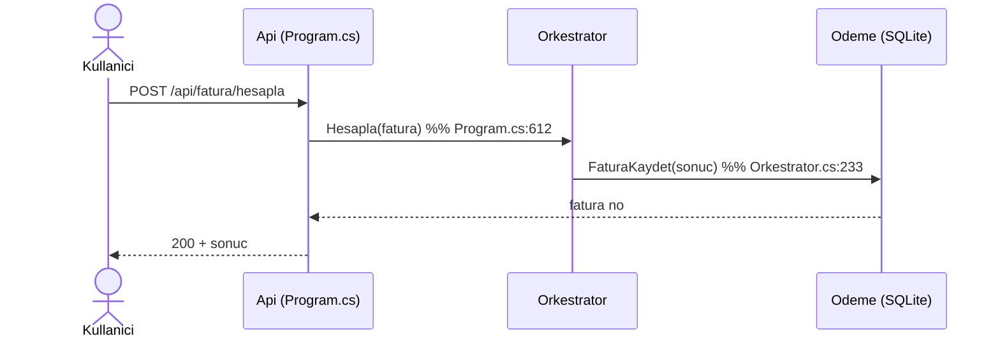

# The document set — templates and the rules that keep them honest

Read this at step 6, before writing; the reading of step 4 is done by then.
The two generated files (`rontgen.md`, `yapi.md`) already exist by then; what
follows are the documents a reader writes, and what stops them from turning
into confident fiction.

## The one rule: every arrow and every sentence has a source

A diagram is a claim set. Each arrow says "this calls that" or "this reads
that", and a reader will trust it more than prose because it looks like a
measurement. So:

- **Cite or tier.** Every arrow, step and statement carries a source
  (`file:line`, a test name, a row of `yapi.json`) or the tag `[H]`. A diagram
  with no sources is `[H]` as a whole, and says so in its caption.
- **Trace, do not recall.** A flow is drawn by opening the entry point and
  following the calls, one hop at a time. If a hop goes through reflection,
  dependency injection, a queue or a rule engine, the arrow stops there and
  the gap is written on the diagram — not bridged by what the code "probably"
  does.
- **Someone else checks, not you.** `python scripts/atif.py --docs <dir>
  --ornek 12` draws a random checklist of cited sentences. It is filled in by
  a reader who did not write the documents — a person, or a fresh session
  given only the documents and the repository. The writer re-opening their
  own citations proves the line exists, not that the sentence about it is
  true. Report "N of 12 held" in the coverage statement; if nobody else is
  available, say **arbiter = author** and the documents stay `[H]` as a set.
- **Write down what you read, as you read.** `okunan.tsv`:
  `path<TAB>from<TAB>to`, one row per range opened. `scripts/kapsam.py` turns
  it into the coverage ledger — per module, how much the documents rest on
  and which slice comes next. Without it the ledger says "olculmedi", and a
  remembered "about a fifth of the module" is worth what any remembered
  number is worth (on the first run it was 14%, and 6% of the repository).
- **A citation carries the commit and an anchor.** State the commit the
  lines belong to, and cite what is on the line, not only its number
  (`Program.cs:452` `Yetkili`). Line numbers in a hot file rot within hours:
  on the first real run, fifteen of 162 citations were eleven lines off
  because another commit landed between the reading and the writing — and
  the three-arrow sample had passed. So keep a sidecar `atiflar.tsv` as you
  read — `path<TAB>line<TAB>text on that line`, with `# commit: <sha>` on top —
  and run `python scripts/atif.py --repo . --docs <dir>` before delivery.
  `KAYIK` with a suggested line is a renumbering; `KAYIK … hic yok` means the
  code changed and the sentence must be re-read. `CAPASIZ` citations are
  unchecked: run `--capala` right after writing (it anchors each to the line
  as it is now, and refuses any file that changed since the sidecar's commit
  — anchoring to moved code would launder a stale citation). `ARALIK`: a
  range whose end is unanchored. `BELIRSIZ`: the name fits several files —
  cite a longer path. `BAYAT`: a document resting on files that have changed
  since; re-read before trusting it. `COKLU` (warning): the anchor text is on
  other lines of the file too — on a second run 38 of 84 anchors were words
  like `else` or `uint32_t`; pick a longer piece of the line.
- **One claim, one anchor.** A cited line supports only what is on it. In a
  blind check of 20 cited sentences, 19 cited the right place but 10 said more
  than their line shows: an opcode list cited to a forward declaration, a
  column schema cited to a header comment, "every command burns fuel" cited
  to the helper's definition. Cite each part, or a range that holds them all,
  or tag the rest `[H]`. Glossary and data-map cells are where this fails most.
  A second blind check, after this rule, held 12 of 20; of the eight that did
  not, two cited a line "civari" (the right text was 6 and 15 lines away) and
  three generalised from a single line ("a grammar", "all paths use this
  name"). So: no approximate line numbers — exact line or range; and a
  generalisation states its base ("3 of 41 `.ctab` files opened") or is `[H]`.
  A third blind check, on a foreign Rust repository, held 15 of 20; all four
  that did not follow from their line were the right line carrying an intent
  ("kept together on purpose"), a scope ("the only real entry") or a process
  note, or a function-level claim cited to a module's first-line comment.
- **Stop at the edge of what was read.** Name the files that were opened. A
  module note written from file names is `[H]` and must say it.

## 1. Reading order — `okuma-sirasi.md`

Five to ten files, ordered so each makes the next easier. One line each:

```markdown
1. `path/to/file` (N lines) — what you learn here, and why it comes first.
```

Start from an entry point in `yapi.md`, not from the largest file. End with
the top hotspot: by then the reader has the vocabulary for it.

Above the list: the second reader's counts (or "no second reader"), the
coverage share from `kapsam.md`, and links to `mimari.md`, `rontgen.md` and
`yapi.md`. Below it: what was left out of scope, by name.

## 2. Module note — `moduller/<module>.md`

One per module in the block diagram; half a page.

```markdown
# <module>

**Responsibility** — one sentence. If it needs "and", note both and say so.
**Size and heat** — files, lines, hotspot rank (from rontgen.md).
**Leans on** — modules it depends on, with the tier of each edge (yapi.md).
**Leaned on by** — who breaks if this changes.
**Public surface** — the types / functions other modules actually use
  (yapi.json → most_used_files), each with `file:line`.
**State it owns** — tables, files, caches; who else touches them.
**Core types** — the three to six types the rest of the module is built from:
  what each holds (fields that matter, `file:line`), which one owns which, and
  **how a value is made and changed**: the constructor or builder the rest of
  the code calls (search for its callers; the most called one is the main
  interface), and whether a change edits in place or returns a new value.
**What surprised the reader** — one or two things a newcomer would get wrong.
**Not read** — files in the module that were not opened.
```

## 3. Function walkthrough — inside the module note, hotspots only

Not for every function: for the three to five that carry the module. Each:

```markdown
### `Name` — `file:line`, N lines
- **Does:** one sentence, in domain words.
- **Inputs / outputs:** including what it reads or writes besides its arguments.
- **Steps:** numbered, each with a line range (`:120-134`).
- **Can fail by:** the branches that throw or return early, and who handles them.
- **Tested by:** test name, or "no test names this function" `[H]`.
```

If a function needs more than seven steps to describe, that is itself the
finding: record it and stop.

## 4. Flow — `akislar/<flow>.md`

The three to five flows that matter most to the business (ask the owner which;
do not guess from route names). One sequence diagram each:

````markdown
# <flow name>

Trigger: <who does what>. Ends when: <observable result>.



| Step | Source | Tier |
|---|---|---|
| A→O | `Program.cs:612` | [K] read |
| O→D | `Orkestrator.cs:233` | [K] read |

**Guarantees on this path:** authorisation check at …, transaction boundary at ….
**Where it can stop half-way:** ….
**Sample check:** 3 of N arrows re-opened — all held.
````

Use `flowchart` instead when the flow is a decision (which queue, which
approval level) rather than a conversation.

## 5. Data map — `veri.md`

From the stores section of `yapi.md`: the tables that matter, who writes each,
who reads each, and an `erDiagram` of the ten most-mentioned. Mentions are
`[H]`; a table marked "written by X" needs the INSERT or UPDATE cited.

## 6. Glossary — `sozluk.md`

Domain word ↔ the name the code uses ↔ where it is defined. In a codebase
written in one language about a domain in another, this is the single most
useful page for a newcomer, and the one most often missing.

## 7. Scorecard — `skor-karti.md`

The numbers to compare next time, copied from `rontgen.json` and `yapi.json`
with the date and the commit. No composite score.

## 8. Architecture page — `mimari.md`

Why it exists: on a large repository, three fresh sessions (with and without
this skill) each traced the main flow correctly and none named the design
ideas the authors' own document opened with — how state is owned, which
values are never changed in place, what a view or a session is. A reader
given only the documents could not answer where per-view state lives. The
flow says *how it runs*; this page says *what it is made of*. Three parts,
each short:

**a. Map.** The block diagram from `yapi.md`, cut to the eight to twelve
parts a newcomer needs, one sentence of role per box. Edges come from the
measurement (`[K]` or `[H]` as there); a role read from code cites a line,
a role guessed from a name carries `[H]`. Under the map, from `paket.md`:
each layer's **feature-gated** external dependencies and its **test-only**
internal ones, citing the manifest line. Five runs missed that a layer meant
to stay independent of the terminal was tied to it; the tie was an optional
dependency behind a feature, visible only in the manifest.

**b. Who owns what.** The handful of core types and the state each holds,
as a table and a `classDiagram`:

```markdown
| Type | Holds (field) | Owned by (owner's field) |
|---|---|---|
| `Session` | open documents `src/sess.rs:12` | `App.session` `src/app.rs:40` |
| `Document` | **one selection per view** `src/doc.rs:120` | `Session.docs` `src/sess.rs:12` |
```

Each cell carries its own citation: "holds" cites the field in the type,
"owned by" cites the field in the *owner* that holds it. Twice, a blind
reader faulted an owner cell whose only citation was the owned type's own
field — that line cannot show who holds it. A surprising ownership (state kept per
view inside the document, a cache owned by its caller) is the most useful
line on the page; say it in words under the table.

**c. Recurring patterns.** Two to five design moves the code repeats, each
with its name in the code and two or three places it shows (`file:line`):
values returned rather than changed in place, an edit carried as an object
that can be inverted, work deferred through events and hooks, a layer stack
for input. A pattern seen in one place is a fact about that place, not a
pattern; say how many places were looked at, or tag it `[H]`.

Extra detail raises the chance of a wrong sentence: in the same test, a
reader answered one question with a true detail from a risk note (a stale
state still starting a server) instead of the actual default that caused it.
Put the cause before the exception, and let the second reader sample this
page like any other.

**Keep the reports.** With no access to the code, a reader answered two
questions in part, and narrowed a third, from function names in the outline
in `yapi.md` that no hand-written page contained. Deliver `rontgen.md` and `yapi.md` beside the documents and link
them from the reading order.

## What to leave out

- A diagram of everything. Thirty boxes teach nobody; `yapi.md` already has
  the full graph as data.
- Line-by-line narration of code that reads fine on its own.
- Recommendations. They go to iskele as tasks, with acceptance criteria.
